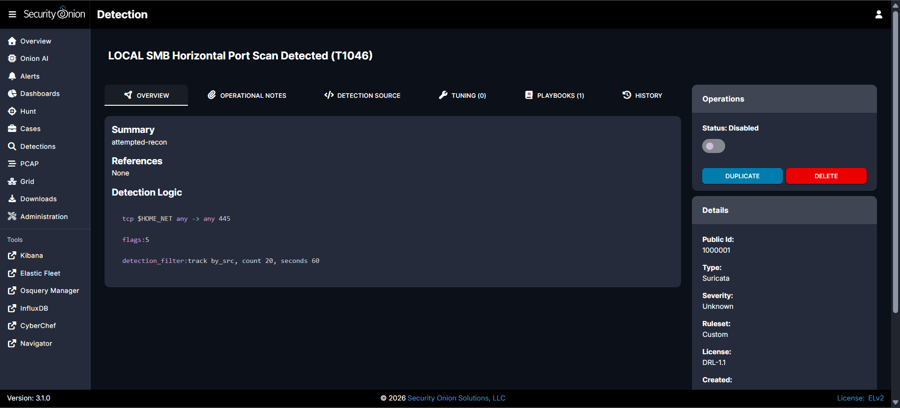
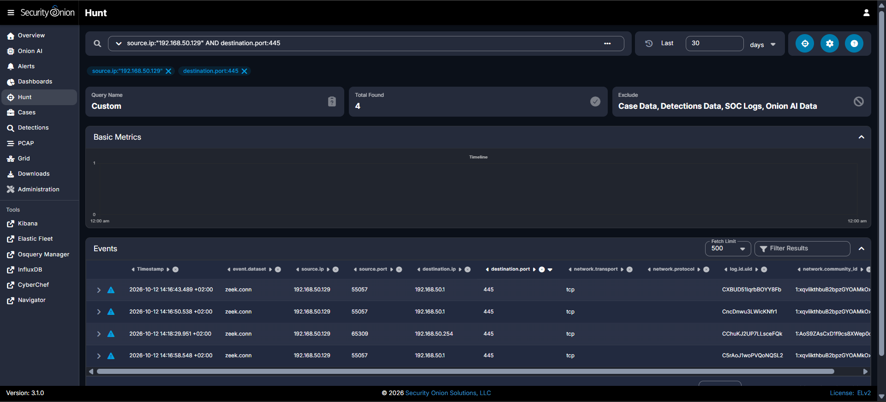
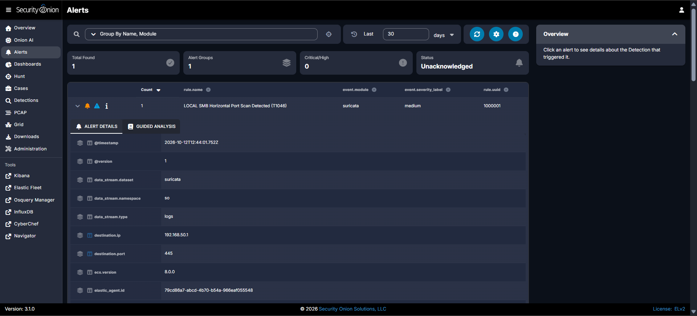

# Custom Suricata Detection — Horizontal SMB Port Scan (T1046)

A custom network IDS rule written and validated in my home Security Onion lab to detect a horizontal port scan that the default ruleset missed. The interesting part isn't the rule — it's that **it didn't fire the first time**, and the debugging is what made it a real detection-engineering exercise.

**MITRE ATT&CK:** [T1046 — Network Service Discovery](https://attack.mitre.org/techniques/T1046/)
**Platform:** Security Onion 2.4 (Suricata + Zeek + Elastic Stack)

---

## The gap

In earlier testing, a PowerShell `/24` port scan (Atomic Red Team T1046-10) across TCP/445 was fully visible in Zeek's `conn.log`, but **no Suricata alert fired**. Horizontal port-scan signatures are disabled by default in the ET Open ruleset to reduce noise in production. That's a legitimate, common analyst scenario: traffic can be captured and logged while still never triggering an alert. So I wrote my own rule to close the gap.

## The rule

```
alert tcp $HOME_NET any -> any 445 (msg:"LOCAL SMB Horizontal Port Scan Detected (T1046)"; flags:S; detection_filter:track by_src, count 3, seconds 60; classtype:attempted-recon; sid:1000001; rev:2;)
```

Why these choices:

- **`flags:S`** — match SYN-only packets, i.e. connection *attempts*. This is the key to catching a scan against closed ports (`S0` connections that never complete), which a payload- or flow-based rule would never see.
- **`detection_filter: track by_src, count 3, seconds 60`** — the actual "scan" logic: alert once a single source makes 3+ SMB connection attempts within 60 seconds. (See tuning below for why `3`.)
- **`classtype:attempted-recon`** — categorizes the alert (Suricata maps this to "Attempted Information Leak", medium severity).
- **`sid:1000001`** — local SID range, so it never collides with vendor rules.



## It didn't fire — so I diagnosed it

First validation run: **no alert**. Rather than tweak blindly, I confirmed the rule was enabled and that Suricata was healthy, then pulled the telemetry in Hunt:

```
source.ip:"192.168.50.129" AND destination.port:445
```

Only **4 connection attempts** showed up, spread across ~2 minutes.



**Root cause:** my rule required 20 SYNs in 60 seconds, but an isolated host-only `/24` only has a couple of hosts that answer ARP, so the whole scan produced ~4 packets. On a directly-connected subnet, Windows never even sends a SYN to a dead host (ARP fails first). A busy production network throws hundreds of SYNs; this quiet lab throws four. The rule wasn't broken — **the threshold didn't match the environment's baseline.**

## Tuned to the environment, and it fired

I dropped `count` from `20` to `3` (matching the observed burst of three attempts to one host within ~15 seconds), re-ran the scan, and the detection fired:



`rule.uuid 1000001` · `event.module: suricata` · severity `medium` · source `192.168.50.129` → dest `192.168.50.1:445`.

## Takeaway

**Detection thresholds have to be tuned to the environment you're actually watching, not to a default.** A count that's normal on one network is silence on another. The workflow here — hypothesis → signature → negative result → telemetry verification → root-cause → tune → confirm — is the realistic version of detection engineering, and a stronger story than a first-try success.
