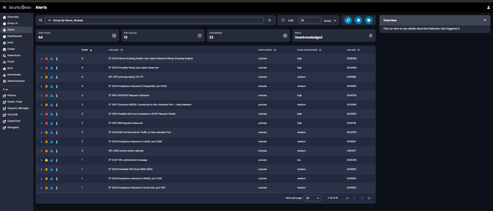
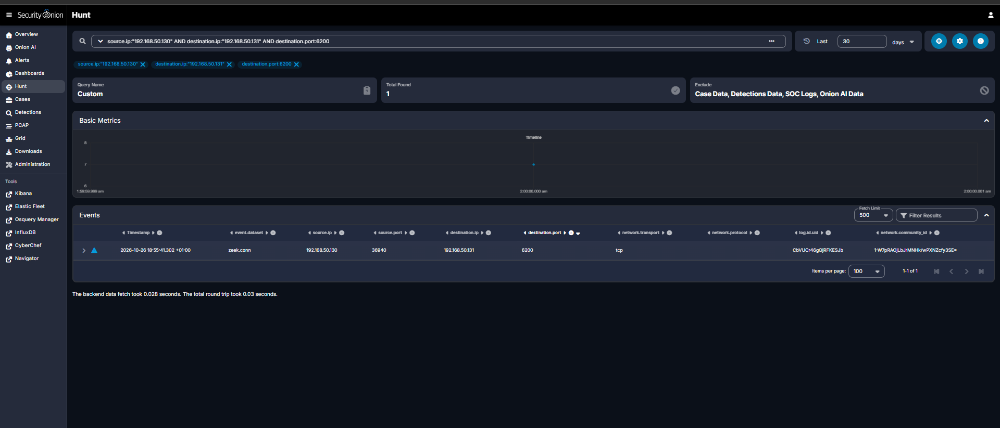
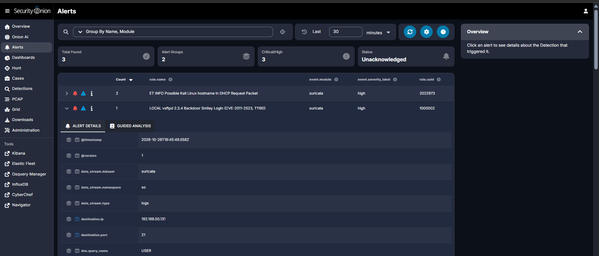

# Purple-Team Exercise — vsftpd 2.3.4 Backdoor vs. Security Onion

A full red-to-blue exercise in my home SIEM lab: compromise a target from Kali, then reconstruct the attack from the defender's chair in Security Onion, identify what the sensors missed, and write a custom detection to close the gap. The headline finding is the one that matters most in real SOC work — **the noisy reconnaissance was caught loudly, but the quiet steps that actually compromised the host produced no alerts at all.**

**Date:** 2026-10-26  **Platform:** Security Onion 2.4 (Suricata + Zeek + Elastic)
**Attacker:** Kali Linux `192.168.50.130`  ·  **Target:** Metasploitable 2 `192.168.50.131`  ·  Isolated host-only network (VMnet2)

---

## Attack chain (red)

### 1. Reconnaissance — `nmap -sV` (ATT&CK T1595 / T1046)
```
sudo nmap -sV 192.168.50.131
```
Enumerated 23 open services with versions, including the deliberately vulnerable `vsftpd 2.3.4` (FTP/21), Samba 3.x (139/445), UnrealIRCd (6667), Java RMI (1099), Tomcat (8180), and more. Those version strings are the roadmap.

### 2. Initial Access — vsftpd 2.3.4 backdoor (ATT&CK T1190, CVE-2011-2523)
vsftpd 2.3.4 shipped with a malicious backdoor: an FTP `USER` whose name ends in `:)` causes the daemon to open a **root bind shell on TCP/6200**.

The Metasploit module (`exploit/unix/ftp/vsftpd_234_backdoor`) failed on this build (v6.4.135) because its expected `cmd/unix/interact` payload is no longer compatible, and the default reverse payload can't work against a raw bind backdoor. So I exploited it **manually** — a more instructive path that proves exactly what the backdoor does:

```
# Terminal 1 — trigger the backdoor
nc 192.168.50.131 21
USER backdoor:)
PASS x

# Terminal 2 — connect to the root shell it opened
nc 192.168.50.131 6200
id        -> uid=0(root) gid=0(root)
hostname  -> metasploitable
```

### 3. Foothold — root bind shell (ATT&CK T1059 / T1571 non-standard port)
Root on the target via the 6200 bind shell. Full chain: **recon → exploit → root foothold.**

---

## Defender's reconstruction (blue)

Flipping to Security Onion and reconstructing each stage:

| Stage | ATT&CK | Captured by sensor? | Alerted? |
|---|---|---|---|
| Recon (nmap `-sV`) | T1595 / T1046 | Yes | **Yes — heavily** (44 alerts across 15 signatures) |
| Exploit (vsftpd `:)` backdoor) | T1190 | Yes (Zeek ftp.log / conn.log) | **No — gap** |
| Foothold (root shell on 6200) | T1059 / T1571 | Yes (Zeek conn.log) | **No — gap** |

**Recon was over-detected.** The nmap scan tripped "ET SCAN Nmap Scripting Engine User-Agent," "ET SCAN Possible Nmap User-Agent," "GPL RPC portmap listing," and a spray of "ET SCAN Suspicious inbound to [PostgreSQL/MySQL/MSSQL/Oracle/VNC]" as it touched each service — plus INFO alerts for RMI, GIOP/IIOP, and IRC fingerprinting.



**The exploit and foothold were invisible to the alert feed.** No signature fired on the `:)` backdoor login or on the 6200 root shell. A SOC watching only alerts would conclude "someone scanned us" and completely miss that the host was rooted.

### Visibility vs. detection
I confirmed this was a **detection gap, not a visibility gap** by hunting the raw telemetry:
```
source.ip:"192.168.50.130" AND destination.ip:"192.168.50.131" AND destination.port:6200   -> 1 zeek.conn event
source.ip:"192.168.50.130" AND destination.ip:"192.168.50.131" AND destination.port:21     -> 3 zeek.conn events (one tagged protocol: ftp)
```
The sensor watched the entire compromise happen — it simply had no rule to flag it.



---

## Closing the gap (detection engineering)

I wrote a custom Suricata rule to detect the backdoor login — the exploit *attempt* itself, not just a successful compromise:

```
alert tcp $HOME_NET any -> $HOME_NET 21 (msg:"LOCAL vsftpd 2.3.4 Backdoor Smiley Login (CVE-2011-2523, T1190)"; flow:established,to_server; content:"USER "; nocase; content:"|3a 29|"; distance:0; classtype:attempted-admin; sid:1000002; rev:1;)
```

Design notes:
- **`content:"USER "` + `content:"|3a 29|"`** — matches an FTP `USER` command carrying the `:)` smiley (`|3a 29|` is hex for `:)`), the signature of the backdoor trigger.
- **`flow:established,to_server`** — only the client→server command stream after the TCP handshake.
- **`$HOME_NET -> $HOME_NET`** — scoped for an all-internal isolated lab. The stock ET rule is written `$EXTERNAL_NET -> $HOME_NET`, which is likely exactly why it never fired here: in a flat lab, the attacker is also inside HOME_NET.
- **`sid:1000002`** — local SID range, so no collision with vendor rules.

Deployed via the Security Onion Detections UI (DRL license), enabled, synced to Suricata.

### Validation
Re-sent the smiley login. This time the backdoor itself returned `500 OOPS: priv_sock_get_result` and the shell did **not** open — but the rule **still fired**:

> **LOCAL vsftpd 2.3.4 Backdoor Smiley Login (CVE-2011-2523, T1190)** — `rule.uuid 1000002`, high severity, `destination.ip 192.168.50.131`, `destination.port 21`.



That it fired on a *failed* attempt is the point: a good detection catches the adversary trying, regardless of whether they succeed.

---

## Lessons
- **Recon is over-detected; exploitation and C2 are under-detected.** Scanning is noisy and signature-rich; the specific exploit and the foothold slip past default rules. This mirrors real breaches, where the loud early noise masks the quiet steps that actually matter.
- **Detect the attempt, not just success.** The rule alerted even when the backdoor failed — exactly the coverage you want.
- **Ruleset scoping matters.** `$EXTERNAL_NET -> $HOME_NET` assumptions silently fail in a flat/internal environment; always validate that a signature's network variables match your topology.
- **When the tool breaks, understand the vulnerability.** Metasploit's payload incompatibility was a dead end; manual exploitation with netcat worked and taught the mechanism better than a one-click would have.
- **Same workflow as real detection engineering:** attack → identify the gap in telemetry → author the detection → validate it fires.

## Files
- `vsftpd-backdoor.rules` — the custom Suricata rule (sid:1000002)
- `images/` — screenshots: recon alerts, the detection gap in Hunt, and the fired custom-rule alert
